<div align="center">


# eSIM Dafter

**Offline-first eSIM & SIM sales management for independent sellers.**
Track supplier balances, customers, lines, payments, and profit — with or without internet.


-orange)


[Download APK](#-download-apk) · [Features](#-features) · [Architecture](#-architecture) · [Screenshots](#-screenshots) · [Contact](#-social-links)

</div>

---

## 📖 Project Overview

**eSIM Dafter** (*dafter* = "notebook / ledger" in Arabic) replaces the paper notebook and scattered spreadsheets that SIM and eSIM resellers rely on. A seller buys stock from supplier companies, sells lines to customers, collects payments (often in installments), and needs to know at any moment:

- How much balance is left with each supplier?
- Which customers still owe money?
- Which lines expire soon?
- What is my real profit?

The app answers all of these from a single, fast, **offline-first** interface. Every action is written to a local SQLite database first and synchronized to the cloud in the background, so the seller can keep working with a weak or missing connection and never lose data.

The app is **Arabic-first (RTL)** with full English support, light/dark themes, and a configurable currency symbol (default `₪`). It is distributed directly to sellers as an APK (one license per device) and ships with its own **in-app update mechanism**.

---

## 🧰 Tech Stack

| Layer | Technology |
|---|---|
| **Framework** | Flutter (Dart SDK `^3.11`) |
| **State Management** | `flutter_bloc` (Bloc / Cubit) + `equatable` |
| **Dependency Injection** | `get_it` (composition root in `core/di`) |
| **Local Database** | `drift` + `sqlite3` (source of truth, versioned migrations) |
| **Backend / BaaS** | `supabase_flutter` — Auth, Postgres (RLS), Storage, Realtime |
| **Authentication** | Supabase Auth (email + password), Google Sign-In, deep-link callbacks |
| **Connectivity** | `connectivity_plus` |
| **Localization** | `easy_localization` (Arabic / English, RTL) |
| **Charts** | `fl_chart` |
| **Export & Sharing** | `excel`, `pdf`, CSV, `share_plus`, `open_filex` |
| **Notifications** | `flutter_local_notifications` + `timezone` (scheduled, local) |
| **Media** | `image_picker`, `record`, `audioplayers` |
| **Web Integration** | `webview_flutter`, `http`, `url_launcher` |
| **Device / App Info** | `device_info_plus`, `package_info_plus`, `path_provider` |
| **Tooling** | `build_runner`, `drift_dev`, `flutter_launcher_icons`, `flutter_native_splash`, `flutter_lints` |
| **Typography** | IBM Plex Sans Arabic (bundled) |

---

## 🏗 Architecture

The project follows a **feature-first, layered architecture** built around an **offline-first** data flow.

### High-level data flow

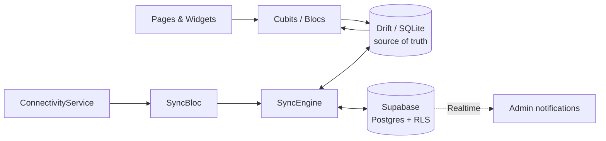

### Key architectural decisions

- **Offline-first.** Every feature reads and writes the local Drift database first. Rows carry a `synced` flag; the `SyncEngine` pushes unsynced rows (`upsert`) and then pulls the server state, in a dependency-safe order (companies → packages → customers → lines → …).
- **Resilient sync.** Each sync step is isolated, so a failure in one table never blocks the rest. Permanent deletes are tracked in a `pending_deletes` table and flushed *before* pulling, preventing deleted rows from being resurrected.
- **Visible backup status.** `SyncBloc` + `SyncStatusIndicator` tell the seller how many changes are not yet backed up, so they know when it's safe to clear data or switch devices.
- **Multi-tenant by design.** Every tenant table carries an `owner_id` (`TenantColumns`) and is protected by Postgres **Row Level Security**. A `profiles.role` (`seller` / `admin`) gates the admin area.
- **Strict feature boundaries.** Feature modules never import each other. Cross-feature access goes through narrow interfaces in `core/` (`CompanyCatalog`, `CustomerCatalog`) and named routes (`RouteNames`).
- **Composition root.** `core/di/service_locator.dart` is the single place that wires app-lifetime singletons (Cubits, database, sync, auth).
- **Graceful degradation.** If Supabase is not configured, the app runs fully offline against Drift. `flutter test` automatically forces this mode for predictable tests.
- **Store-less distribution.** Updates are published as rows in an `app_releases` table plus an APK in Supabase Storage; the app compares build numbers and offers (or forces) the update.

### Per-feature layering

```text
feature/
├── domain/
│   └── entities/        # Pure Dart models (Equatable)
├── data/                # Exporters / providers (where needed)
└── presentation/
    ├── cubit/           # State + business logic
    ├── pages/           # Screens
    └── widgets/         # Feature-specific UI (sheets, cards, forms)
```

---

## ✨ Features

### 🧾 Sales & Inventory
- **New Sale wizard** — 4 guided steps: *Customer → Package & Price → Payment → Confirm*, with inline customer creation.
- **Supplier companies** — manage companies and their packages; **import ready-made** companies from an admin-curated shared catalog.
- **Shipments & operations** — record stock purchases with paid/unpaid remainders; browse the full operations history.
- **Balance tracking** — live "available to sell" balance per supplier on the dashboard.

### 👥 Customers & Lines
- Customer profiles with contact launcher (call / message).
- Lines (SIM / eSIM) with purchase & expiry dates, wholesale cost, retail price, auto-computed profit, and payment status.
- **Installment payments** and **additional services** per customer.
- Historical snapshots keep sold lines displaying correctly even if a company is later renamed, archived, or deleted.

### 📊 Insights
- **Dashboard** with total sales, profit, uncollected amounts, new lines, plus sales/profit and profit-trend charts.
- **Profits** and **Reports** pages with period filters (preset ranges + custom date range).
- **Numbers** directory of all sold numbers with search, filters, and pagination (50 / 100 / 200 / All).
- **Activity log** — an audit trail of important actions.

### 📤 Export
- Export tables to **CSV, Excel (.xlsx), and PDF** and share them directly (Reports, Numbers, Shipments & Operations).

### 🔔 Smart Notifications
Locally scheduled — no server push needed:
- Line expiring in 3 days / line expired today
- Customer debt reminders (auto-cancelled once paid)
- Company low-balance alert
- Amount owed to a supplier after a shipment
- *(Admin)* Live alert when a seller submits a support request

### 🔄 Number Update
- Refresh subscription numbers through supported provider endpoints (Liyan, QuickLine, Areen, Aloha) and WebView-based flows for providers that require a browser context (SmileSim, Sky), with a local result log and provider cache.

### 🔐 Authentication & Security
- Email/password sign-up and sign-in, forgot/reset password via deep links (`esimdafter://`).
- Google Sign-In (native on Android, OAuth redirect elsewhere).
- Cached role for offline startup; automatic **force-logout** when an admin deactivates an account.
- Change-password flow in Settings.

### 🛠 Admin Console
- **Company catalog** management (shared templates for sellers).
- **User management** — create, activate/deactivate seller accounts.
- **Support & Feedback inbox** with image/voice attachments and realtime updates.
- Admin dashboard with seller, catalog, and request statistics.

### 💬 Support & Feedback
- Sellers can send suggestions or report problems with **image and voice attachments**.

### ⚙️ Personalization & Updates
- Arabic / English with RTL, light / dark mode, custom currency symbol.
- **In-app updates** — checks for new releases, downloads the APK, and hands off to the Android installer; supports **mandatory** updates.

---

## 📁 Folder Structure

```text
sim_sales_manager/
├── android/ · ios/ · macos/ · web/        # Platform runners
├── assets/
│   ├── fonts/                             # IBM Plex Sans Arabic
│   ├── icons/ · images/
│   └── translations/                      # ar.json, en.json
├── supabase/
│   └── migrations/                        # SQL schema, RLS, storage, realtime
├── test/                                  # Unit & widget tests
├── lib/
│   ├── main.dart                          # Bootstrap, routing, session restore
│   ├── core/
│   │   ├── activity_log/                  # Activity logger
│   │   ├── auth/                          # AuthService (Supabase Auth, Google)
│   │   ├── catalog/                       # Cross-feature catalog interfaces
│   │   ├── config/                        # Env, deep links
│   │   ├── constants/
│   │   ├── database/                      # Drift database + tables
│   │   ├── di/                            # get_it service locator
│   │   ├── navigation/                    # Route names, logout, launchers
│   │   ├── notifications/                 # Scheduler, cubit, types
│   │   ├── number_update/
│   │   ├── settings/ · support/
│   │   ├── sync/                          # SyncEngine, SyncBloc, connectivity
│   │   ├── theme/                         # Colors, text styles, ThemeCubit
│   │   ├── update/                        # In-app APK update flow
│   │   ├── utils/                         # Formatters, export, helpers
│   │   └── widgets/                       # Shared UI components
│   └── features/
│       ├── activity_log/   ├── admin/          ├── auth/
│       ├── companies/      ├── customers/      ├── home/
│       ├── more/           ├── new_sale/       ├── notifications/
│       ├── numbers/        ├── number_update/  ├── profile/
│       ├── profits/        ├── reports/        ├── settings/
│       ├── shipments_operations/               └── support_feedback/
└── pubspec.yaml
```

---

## 🖼 Screenshots

| 1 | 2 |
|:---:|:---:|
| 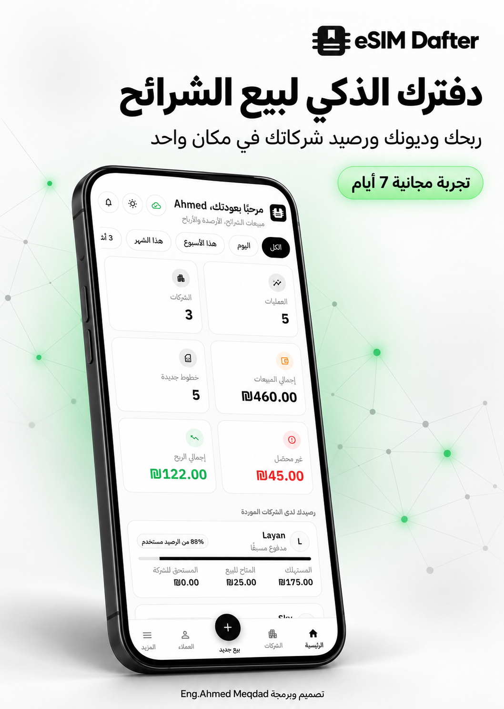 | 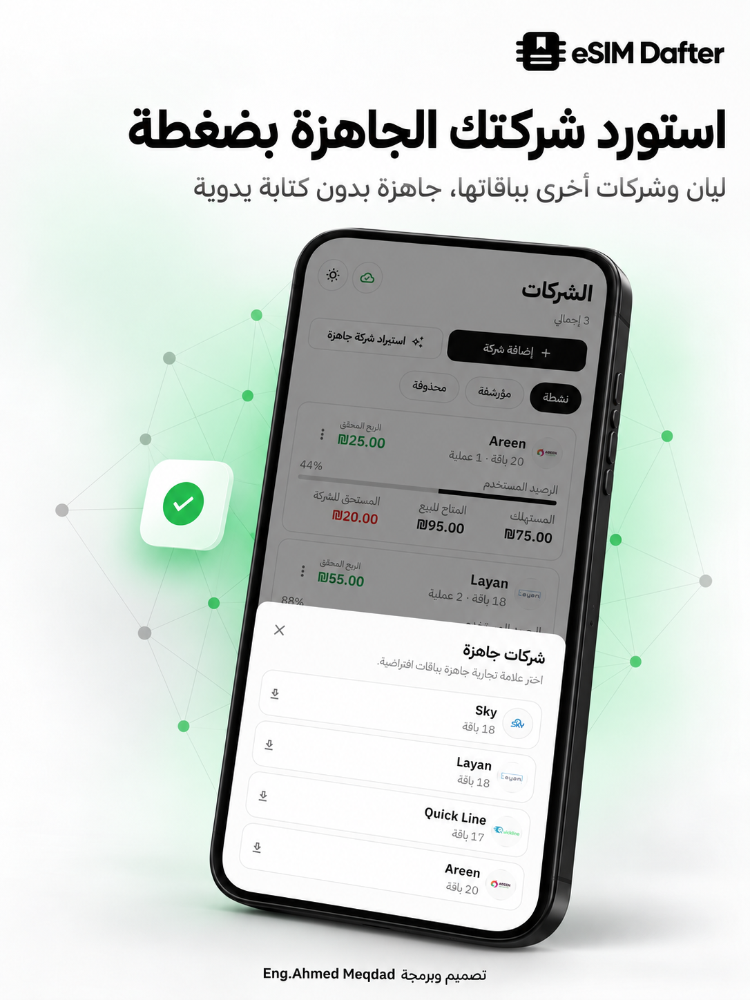 |

| 3 | 4 |
|:---:|:---:|
| 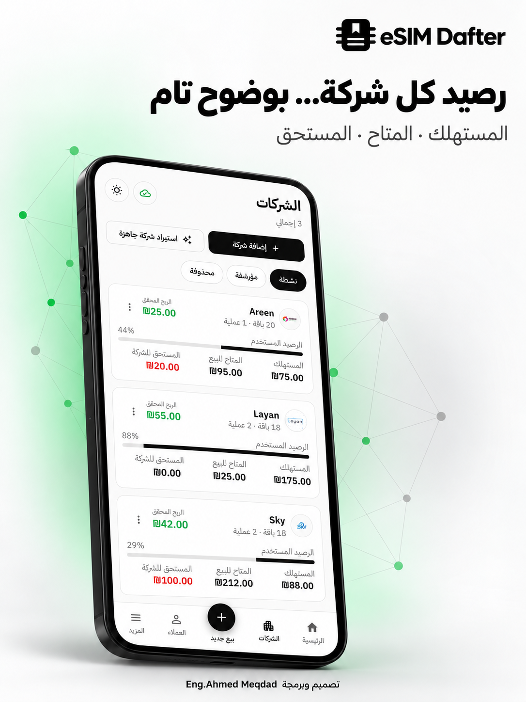 | 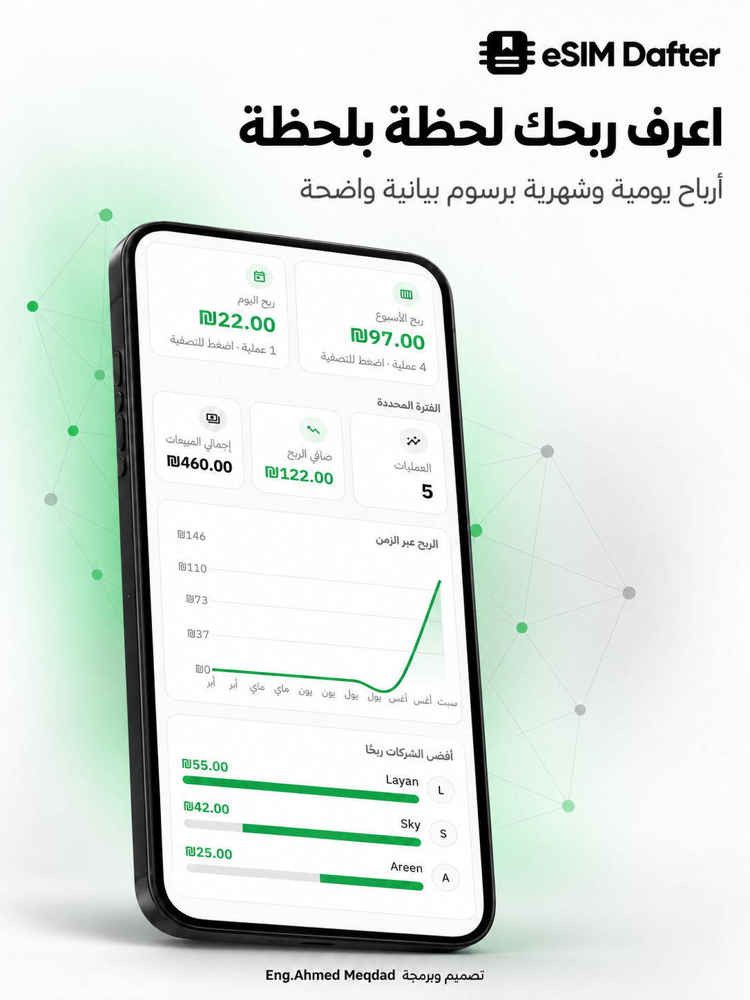 |

| 5 | 6 |
|:---:|:---:|
| 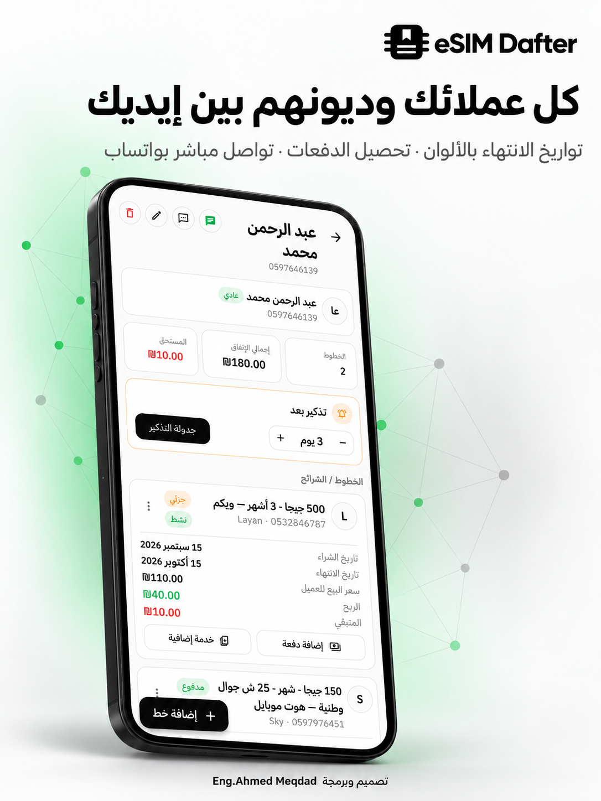 | 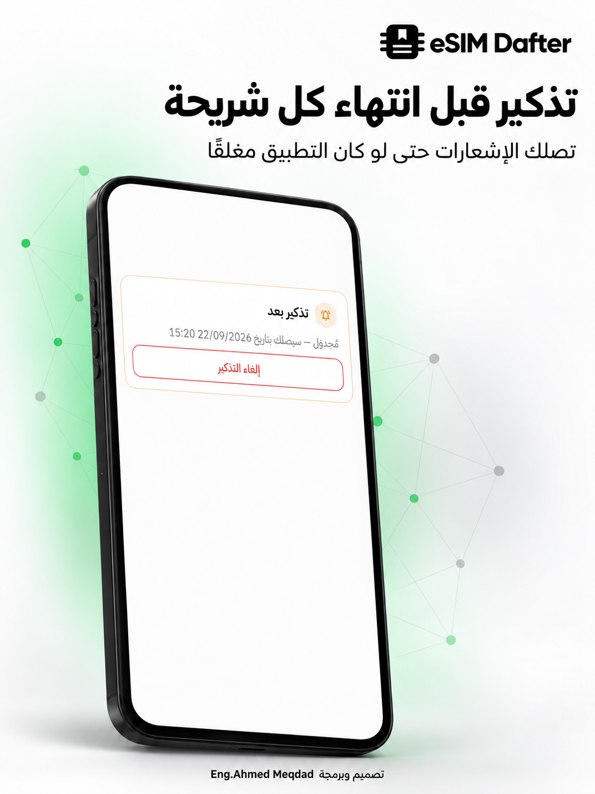 |

| 7 | 8 |
|:---:|:---:|
| 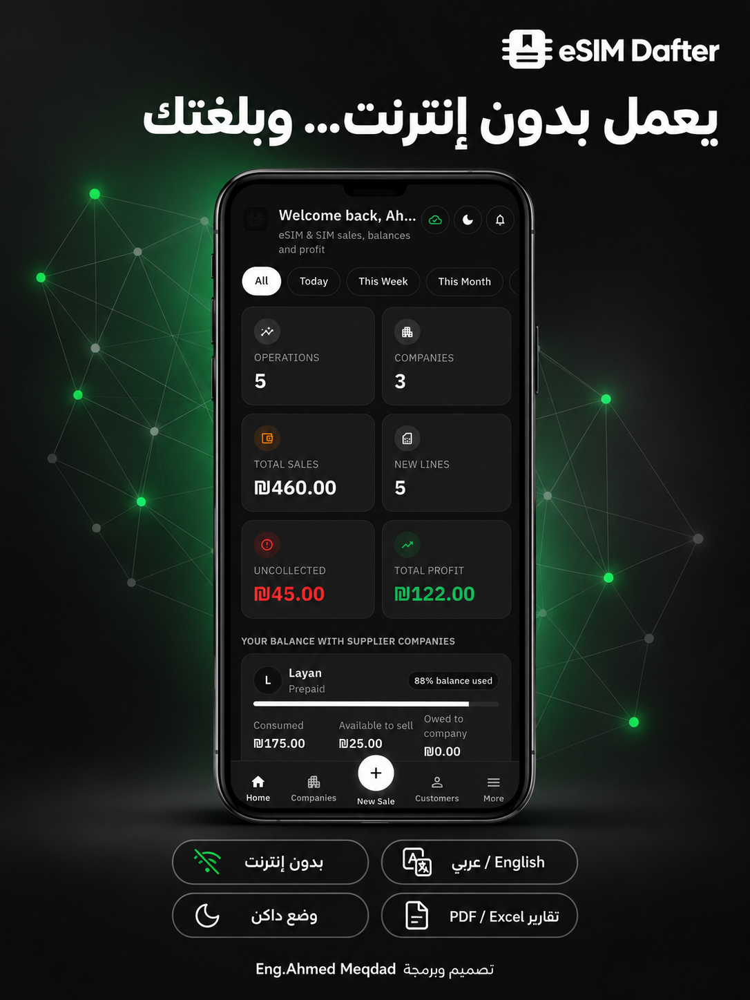 | 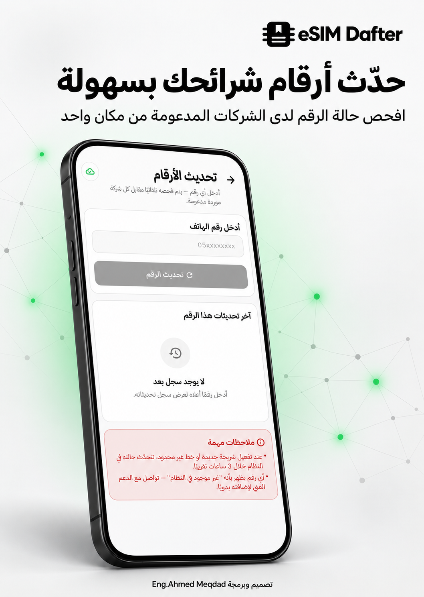 |

| 9 | 10 |
|:---:|:---:|
| 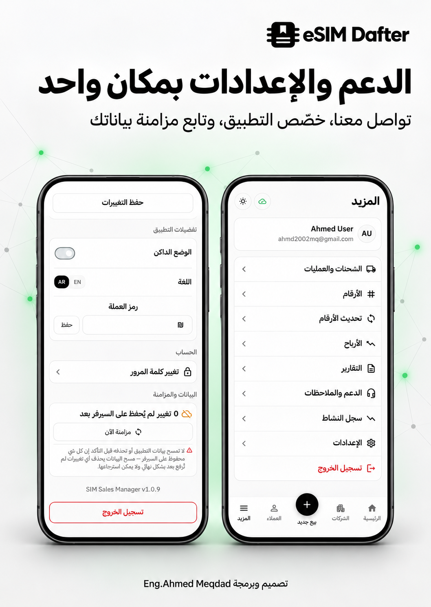 | 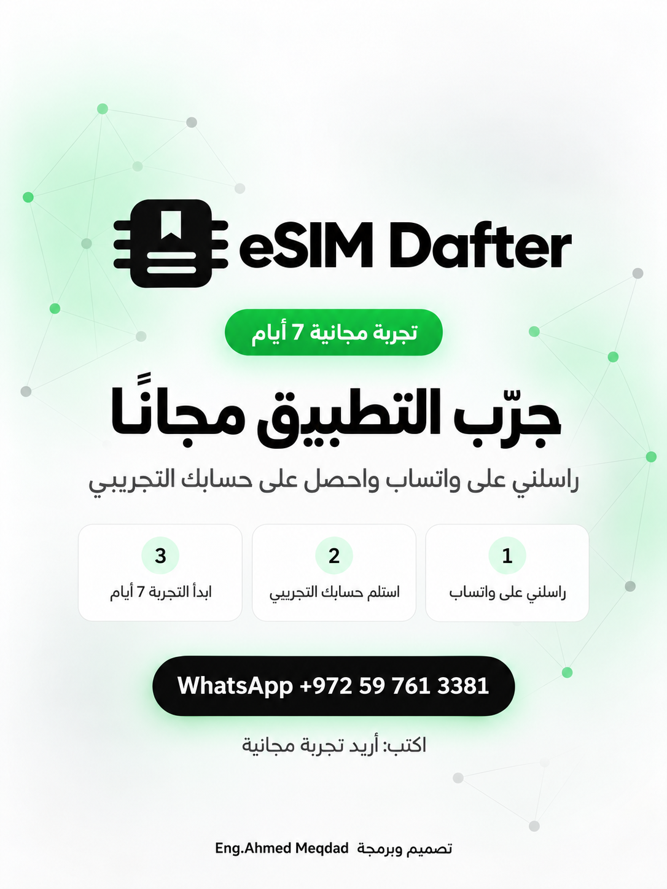 |

---

## 📥 Download APK

<div align="center">

[](https://github.com/a7med2002/sim_sales_manager/releases/latest)

</div>

- **Latest version:** `v1.1.0` (build `11`)
- **Requirements:** Android device; allow *Install unknown apps* for your browser/file manager.
- Already installed? The app notifies you in-app when a newer version is available.

---

## 🌐 Social Links

<div align="center">

[](https://github.com/<username>)
[](https://www.linkedin.com/in/ahmedmeqdad0)
[](https://instagram.com/ahmedmeqdad0)
[](https://t.me/A7med_Meqdad)
[](mailto:ahmd2002mqdad@gmail.com)

</div>

---

## 👨‍💻 Author

**Ahmed Miqdad** — Flutter developer, Gaza, Palestine.

---

<div align="center">

⭐ If you find this project useful, consider giving it a star.

</div>
